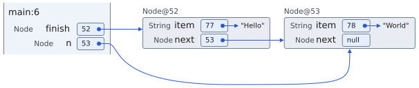

# Reference-arrow routing

Reference arrows prefer clear routes around heap objects while protecting all
visible text, including complete compact string literals. Crossings through
unrelated empty object interiors are allowed when needed for a readable route.
An arrow stops at its target boundary without crossing the target first.
Self-references have a controlled initial departure through their own container. Arrows
retain their source and target identities in every string style.

Sources prefer to leave through the right edge of their reference box when a
clear route fits between the source and arrival with at most two bends and no
backtracking. This preference can add a bend, but never bypasses text, arrow,
or border clearance checks. A preferred right exit may add at most 24 CSS pixels
over the shortest clear direct or one-bend alternative, comparing lengths before
rounding and including the arrowhead. Top and bottom exits remain available when
a rightward route would be crowded or exceed that allowance.
The complete route is checked for source-box re-entry, including rounded corners;
a rightward stub cannot reverse back through the source and leave left.
Arrowheads and hover stroke widths participate in clearance checks. Every shaft
avoids arrowheads for different targets, regardless of routing order; ordinary readable
shaft crossings remain allowed. Parallel or nearly parallel shafts keep at least
six CSS pixels of visible space between their strokes, including hover widths,
when they lead to different targets. Aliases also keep horizontal and nearly
horizontal runs separate outside a 16 CSS pixel arrival corridor around their
shared target. Shared vertical alias routes remain available in crowded diagrams. When separate
arrivals exhaust the search, aliases may share an arrival arrowhead.
For shallow enclosures, such as a row of collection entries, the router prefers
six pixels of clearance beside source-box and enclosing-object borders, including
routes below the source. Tall containers retain shorter field departures. A narrower valid departure remains
available when tightly stacked rows prevent the roomier candidates.
The checks include curved segments through conservative subdivision. Routing
reserves usable departure corridors and tries separate horizontal and vertical
lanes; it validates rounded corners again before painting. Crowded stack columns
also reserve turning space, as does a retry after the initial routing pass fails.
Shorter controlled departures can use clear gaps between tightly stacked rows.
Stack references route first because their aligned source boxes constrain exits.
Simple bends are checked at every attachment. At most 512 additional orthogonal
detours are validated before the visibility grid is used.
Search hints are cached for each occupied route and stroke width and merge
subpixel arithmetic noise; painted geometry is checked at full
precision. Reference routing searches all viable attachment pairs together using
weighted A* (1.25× Manhattan distance), favoring prompt progress over a guaranteed
shortest path. It allows at most 200,000 queue removals per exterior-space retry;
frame-parent searches allow 5,000. Failure still produces an explicit routing error.

Reference-valued map keys use the same value boxes and endpoint spacing as map
values. Map entries have the same enclosing object surface as other heap objects.
Primitive and inline-string keys remain labels. Temporary spacing repairs
are cleared before measuring value widths, so repeated redraws do not alternate
between repaired and intrinsic widths.

Optional environment-frame parent pointers are distinct from value references:
they retain their configured frame-boundary attachment sides. Simple rounded
orthogonal routes are preferred when clear.
Obstructed parent pointers detour around text and frame contents while retaining
the requested attachment sides. The forbidden-left-exit rule applies to reference
boxes, not these frame-boundary links. Left and top detours receive canvas padding
so PNG capture can include paint that would otherwise lie outside the document.

## Example: reference to a later node

[Main.java](Main.java) creates two nodes, then assigns `n` to the second node.
Capture line 6, after that assignment, with compact strings:

```sh
uv run code-visualizer docs/reference-routing/Main.java -b 6 \
  --string-style compact --format SVG -o .scratch/reference-routing/compact.svg
```

The command assumes a checkout with the frontend built; see
[the contributor guide](../../CONTRIBUTING.md). Use `--format PNG` and a `.png`
output filename for a raster image. Replace `compact` with `inline` or `default`
to compare string styles at the same execution state.



The source boxes and nodes retain their positions; the route grows the diagram's
bounds instead of shrinking its text. This is a representative current export,
not a guarantee about every graph. Reference IDs can differ between tracer runs.

## Implementation

`frontend/js/connectorRouting.ts` measures DOM geometry once per routing pass
and caches routes by geometry and maximum paint width. `referenceRouting.ts`
first measures clear direct and one-bend alternatives, then prefers a compact
right exit with up to two bends within the extra-length allowance. If none fits,
it uses the shortest clear simple alternative. When simple candidates fail, it
retains suitable curves, tries broad sweeps and orthogonal detours, then searches
an expanding visibility grid. `connectorGeometry.ts` supplies shared source-dot
and arrowhead dimensions to both the routing checks and the painted connectors.

Text clearance is 1 CSS pixel plus stroke extent. Preferred object clearance is
8 pixels; broad curves begin 32 pixels below relevant objects. Aliases use
separate arrival ports and additional lanes. These are internal routing values,
not public configuration options. Identical geometry and rendering settings
produce identical routes without using navigation history.

Routing preserves placement first. If fixed-position candidates fail, it can
move an object covering a source dot or widen a crowded source or target, then
remeasure the diagram. Repairs are undone and recomputed on each routing pass.
Externally constrained CSS can prevent repair and produce a diagnostic; the
renderer does not silently restore a text-crossing route. Arbitrary dense graphs
still require visual review for traceability.

Interactive padding and export bounds include detours without reducing text size.
Regression tests and measured fixtures live in `frontend/tests/`. Temporary
prototypes, review PDFs, browser captures, benchmark results, and security scans
belong in the ignored root `.scratch/` directory, as required by
[the development-artifact policy](../../CONTRIBUTING.md#development-artifacts).

## Controlled terminal-path sharing

Terminal-path sharing is an internal development policy. The production default
remains the historical routing behavior described above. There is no public
visualizer option or CLI flag for sharing. The connector manager exposes
`setReferenceRoutingPolicy("historical" | "independent" | "shared")` for controlled
comparisons: `independent` establishes the controlled baseline, while `shared`
also evaluates terminal-path proposals. Selecting a development policy is not
evidence that its release acceptance gates have passed.

Both controlled policies construct the same validated independent or explicitly
owned baseline before optional optimization. For aligned ordinary stack
references, an estimate compares distinct-target lane clearance with the
available gap to visible, nonempty heap objects. If the estimate exceeds that gap, those references
use canonical target-first ordering to establish the crowded baseline;
frame-parent and heap-reference slots keep their order. Noncrowded diagrams
retain source ordering. This narrow baseline coordination does not adopt the
separately evaluated general target-first policy.

If incoming references exceed estimated target arrival capacity, or that target
already has an owned suffix, baseline construction can attach a new reference to
a validated existing directed suffix after simple independent candidates are
exhausted. Previously routed paths keep their geometry. The candidate must
respect text, dots, future source departures, and declared ownership, and later
routes must avoid its shared suffix. This establishes a baseline when no route
for the new source has yet been accepted; it makes no optional length-improvement
claim. Baseline groups may therefore exist under `independent` as well as
`shared`, and optional optimization must be compared against that same baseline.

A shared path is a drawing convention for several reference values that refer to
the same object. Every source keeps its value box, dot, distinguishable initial
branch, logical connection, and complete directed route to that object. A join
does not create an object or another reference value. A target may have several
groups and independent arrivals. Exact target identity and compatible persistent
semantic styles are required; equal-looking objects and equal colors do not
establish eligibility. Self-loops, returning references, frame-parent pointers,
and local compact-string arrows retain their existing presentation.

The conservative admission contract compares proposals against one validated
baseline. Every member's complete route length and bend count must be
non-increasing, a clear direct route keeps its geometry, and both unique painted
shaft length and arrowhead count decrease. Unrelated routes and object positions
stay fixed. New joins and the entire shared suffix exclude unrelated crossings
and ambiguous near contacts, including maximum supported emphasis widths.
Ordinary readable crossings remain allowed elsewhere. Rounded geometry, text,
source dots, source exits, and target boundaries retain their clearance checks.
Optional sharing cannot justify extra layout repair or a weaker baseline.

The geometry-only planner first gives any qualifying exact shared suffix
explicit ownership. Optional proposals use one straight monotone spine with
ordered joins and at most one terminal bend. They are partitioned by exact target,
persistent style, supported stroke width, and arrival side. A partition considers
at most four target tips and a finite selection of straight or one-bend spine
profiles, capped at 24 profiles. It does not enumerate arbitrary source subsets
or build general branching trees. A profile can retain maximal contiguous runs
of admissible members, so one protected direct route does not veto a useful
farther group; the retained candidate list also stays capped at 24. The cap bounds operations; measured browser
results are still required to establish performance.

Logical connections remain individually selectable and describable. Shared base
segments and the terminal arrowhead have one physical owner; selecting a member
emphasizes its private branch and complete suffix without changing geometry or
highlighting sibling branches. Persistent style changes can change eligibility;
transient emphasis does not change membership. Identical states and settings
must restore equivalent routes without navigation-history-dependent behavior.

Inspect `manager.referenceSharingPlan` when investigating the controlled policy.
It reports complete logical routes, groups, baseline validity, accepted proposals,
`profilesTried`, and diagnostic reasons for declined proposals. A valid independent arrival is a
normal result when sharing would not improve it. A baseline-validation failure
requires investigation; historical undeclared overlap is not a compliant fallback.
`manager.routing.baselineOrdering` reports `source` or `target` so the crowded
baseline coordination is visible in diagnostics. Plan group count and `accepted`
can include baseline ownership; they do not alone establish an optional gain.
The [benchmark harness](../../scripts/benchmark_reference_routing/README.md)
collects these diagnostics alongside independent/shared comparisons and separate
state/style-transition measurements.

Production enablement requires semantic, geometry, lifecycle, export, performance,
and maintainer visual review of baseline/proposed pairs. Review static exports at
native and reduced size, including monochrome, and check source-to-target tracing,
alias recognition, reference-value versus object counts, and assignment versus
object mutation. These are engineering acceptance tasks, not evidence of improved
student learning or universal readability.

## Validation and performance

Run the geometry regressions from the repository root:

```sh
npm --prefix cs1302_code_visualizer/frontend test -- tests/svgConnectors.test.ts tests/shaftClearance.test.ts
```

The [fixture replay helper](../../cs1302_code_visualizer/frontend/tests/routingFixture.ts)
uses captured DOM rectangles with the production connector manager. Tests cover
text clearance, source exits and re-entry, cycles, aliases, string styles,
repair, and deterministic redraws. The `parallel-*.json` fixtures capture dense
benchmark and example-trace geometry for shaft separation, including crowded
stack exits and aliases. Keep browser/export checks as well: mocked
rectangles alone do not validate fonts, CSS, painted stroke extents, or cropping.
After rebuilding the frontend, run the selected native export checks with:

```sh
uv run pytest --no-cov tests/test_export_cropping.py tests/test_svg_export.py
```

Coverage is disabled only for that selected subset; the repository-wide gate
still applies to the complete Python suite. For visual review, inspect shafts,
dots, arrowheads, and hover widths at native size and reduced zoom. Require clear
text, permitted source exits, distinguishable arrivals, deterministic redraws,
and complete SVG/PNG bounds. Ordinary crossings are acceptable when each path
remains easy to follow; sampled curve points supplement conservative geometry
checks rather than replacing them. See the [SVG review guide](../svg-gallery.md).

The [browser benchmark](../../scripts/benchmark_reference_routing/README.md)
retains the representative traces and dense-scene generator. The agreed budgets
on the measured browser/hardware are:

| Metric | Budget |
| --- | ---: |
| Representative fixtures: p95 full redraw | 16 ms |
| 48 objects / 108 references: p95 full redraw | 50 ms |
| 48 objects / 108 references: maximum fresh layout | 300 ms |

A full redraw includes value-box layout. Fresh layout creates a new visualizer
with warm assets; it does not measure cold loading or a complete execution-step
transition. Record browser, hardware, viewport, and sampling protocol with new
results. These budgets are comparison targets on a controlled environment, not
guarantees for every device. Keep measurements and review reports in `.scratch/`.

The harness retains its original `benchmarkRouting` policy-switch measurement:
public creation initially uses the historical policy, then a controlled policy
selection and final redraw are included in the fresh-layout sample. Its separate
`benchmarkRoutingInitialPolicy` experiment selects the internal policy before
the first connection, using a temporary harness wrapper discovered through an
untimed bootstrap. Both modes retain full public creation and final redraw work.
Record the initialization method and compare shared routing with the strict
independent baseline under that same method. An initial-policy result is an
additional measurement; it does not replace a policy-switch failure or silently
redefine the 300 ms gate. The harness guide details the bootstrap, assertions,
cleanup, and limitations. Run acceptance measurements without competing tests.
